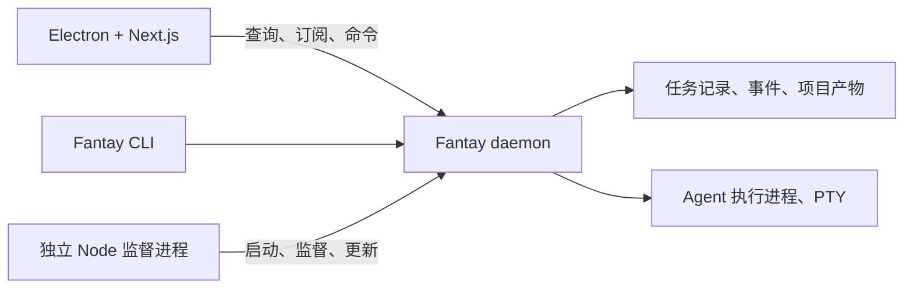

# Fantay 桌面与运行内核独立运行、独立更新

2026-11-12 · macOS standalone 安装包已实现独立内核生命周期和延迟切换。

## 用户可见行为

| 操作 | 运行中的任务 |
| --- | --- |
| 关闭窗口、退出桌面、桌面主进程或渲染进程崩溃 | 原进程继续执行。重新打开界面时接回原任务、输出和待审批操作。 |
| 安装兼容的界面更新 | 只替换桌面和渲染层。内核进程、执行进程、会话 ID 保持一致。 |
| 安装需要重启内核的更新 | 下载和校验可提前完成。正在运行的任务或终端存在时，默认延后激活，由用户选择等待或明确停止。 |
| 主动停止任务或退出后台服务 | 内核记录停止原因并回收相应执行进程。退出后台服务影响整个命名空间。 |
| 内核崩溃、系统退出登录或重启 | 重开后恢复已持久化的状态，核对中断任务。支持检查点的执行器才能从安全位置继续。 |

## 所有权

沿用 `apps/daemon` 作为本地内核，由它管理 run、个人智能体队列与执行尝试、CLI 及 PTY、待审批状态、项目和产物。每个现有命名空间只有一个内核写入其数据。持久数据继续遵循 [Daemon data directory contract](../../AGENTS.md#daemon-data-directory-contract)。

Electron 与 Next.js 渲染层负责窗口、视图、用户输入和系统交互，现有 CLI 接入同一个内核。依赖窗口的操作应显式等待可用客户端或保存后续处理所需的信息。内核负责判断这类操作是否完成。

客户端连接后先读取会话与任务状态，再按 `runId` 和事件游标接入现有 HTTP/SSE。重连补齐断线期间的事件，重复事件按 ID 去重。查询与订阅释放各自的连接资源，取消任务走显式命令。客户端当前选用的模型或运行模式只影响新请求，已有任务按内核记录恢复。

## macOS 实现

- 独立的 Node 监督进程持有 daemon。桌面退出只关闭界面及其 web sidecar。桌面重开按命名空间发现同一内核，并重新登记桌面鉴权和 web 地址。内核持有数据目录的写入锁。[独立启动](../../apps/packaged/src/mac-kernel.ts) · [桌面接入](../../apps/packaged/src/sidecars.ts)
- 安装包附带启动内核所需的 Node 和匹配的 SQLite 模块。桌面首次启动时，将内核入口、依赖和资源按内容版本存入独立目录。兼容的桌面更新使用原内核。内核候选与运行中的版本各有独立路径，替换 `.app` 后后台仍能加载运行资源。[安装包组装](../../tools/pack/src/mac/builder.ts)
- 新桌面发现不同的内核版本时将其暂存。内核在聊天、个人智能体、媒体任务、定时工作、PTY 等活跃工作清空后关闭新任务准入，由监督进程在原端口启动候选。候选启动成功后才写入当前版本。桌面关闭后，已暂存的更新仍能切换。[内核更新](../../apps/daemon/src/sidecar/kernel-update.ts)

## 迁移基线

- 普通项目聊天已有持久事件回放和 `DAEMON_RESTARTED` 对账，个人智能体会把中断尝试留待核对，PTY 会话目前在 daemon 内存中。内核重启之后的恢复策略按执行器分别实现，重试前核对已经产生的文件和外部副作用。[聊天对账](../../apps/daemon/src/runtimes/run-restart-recovery.ts#L21) · [个人智能体对账](../../apps/daemon/src/services/personal-agent-service.ts#L141) · [PTY 状态](../../apps/daemon/src/terminals.ts#L54)

首次从旧安装结构迁移时，旧桌面仍持有旧 daemon，安排在活跃任务结束后切换所有权。原有登录、项目、消息、自动化和已保存设置随同一数据根使用。

内核由安装包首次启动时按需创建。退出登录后的自动启动、发布平台的独立内核分发和数据库迁移失败后的回退仍待验证。

## 安装包验收

使用隔离命名空间与确定性的本地执行替身。记录界面版本与 PID、内核版本与进程实例 ID、执行进程 PID 和任务 ID。

- 开启长任务并等待首段输出。分别关闭窗口、完整退出桌面、强杀 Electron 主进程，再打开桌面。每次均确认同一内核和执行进程仍存活，任务在界面离线期间有进展，补回的输出与产物归属原任务，执行只发生一次。
- 从实际 A 版安装切换到兼容的 B 版界面。界面版本改变，内核与任务进程身份保持一致。覆盖运行中和等待用户输入两种状态。
- 在有活跃任务时请求内核更新，验证候选包只暂存。任务结束后切换一次，校验历史、项目和权限。用故障候选包演练回退，并按实际迁移规则核对数据完整性。
- 单独演练内核意外退出。核对普通聊天和个人智能体的中断状态、PTY 结束、审批和外部工具调用的去重行为。

### 2026-11-12 本机结果

macOS arm64 隔离安装使用本地 Codex 协议替身和独立数据目录。正常退出、强杀桌面主进程、界面 0.25.101 → 0.25.102 三次都保留同一 daemon、同一执行进程和原任务 ID。重开窗口可见离线期间新增的输出，四项任务各启动一次，各自生成并保留一份产物。内核候选 0.25.103 在任务运行时保持暂存，桌面完全退出后，旧任务成功结束才切换，重开可见原会话和产物。界面更新采用本地安装包替换。

同日复测使用「设置 → 关于」的检查更新、下载更新和安装并重启，更新源为本机服务，应用包经过本机签名。桌面 0.25.201 → 0.25.202 时保留原内核和原执行进程，恢复同一任务。桌面 0.25.202 → 0.25.203 时，新内核在活跃任务数为 1 时保持暂存。任务成功并降为 0 后，内核才切换，桌面进程继续运行。独立内核仍报告安装版身份，「关于」显示桌面自己的版本。[内核版本识别](../../apps/daemon/src/app-version.ts)

Rex Server 的会话快照与后续事件序列提供了客户端重连的参考。`rex-harness` 的独立工作流 API 提供了状态机所有权的参考。Fantay 使用现有 daemon、运行记录与事件流实现对应边界。[Rex Server API](https://www.superlogical.com/rex/docs/reference/api#sessionbootstrap) · [rex-harness](https://github.com/rexleimo/rex-harness)
